# Universidad TI · Actividad 6

App en **Flutter** que presenta la oferta académica de una universidad de tecnologías de la información. La pantalla principal muestra las carreras en tarjetas y, al tocar una, se abre su pantalla de **contenido** con ícono, nombre, descripción y botón **Regresar** (navegación entre pantallas con `Navigator`).

| | |
|---|---|
| **Alumno** | Cristopher Gerardo Villanueva Ramírez |
| **Materia** | Desarrollo de Aplicaciones Móviles |
| **Tarea** | 6 |
| **Entrega** | [`Actividad 6.pdf`](<Actividad 6.pdf>) (código y capturas) |
| **Código** | [`universidad_ti/`](universidad_ti/) |

## La app funcionando

<table>
  <tr><td align="center">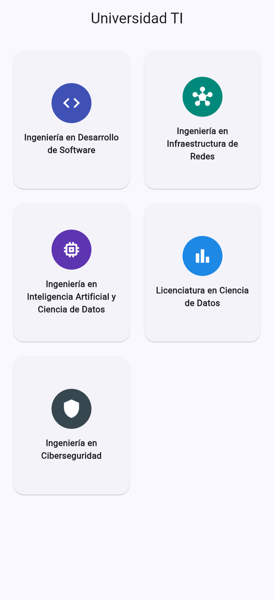<br><sub>Pantalla principal</sub></td><td align="center">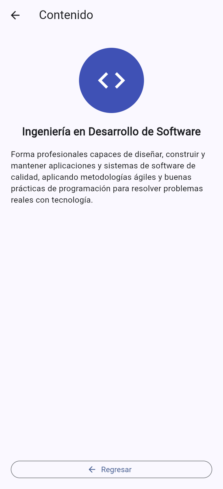<br><sub>Desarrollo de Software</sub></td><td align="center">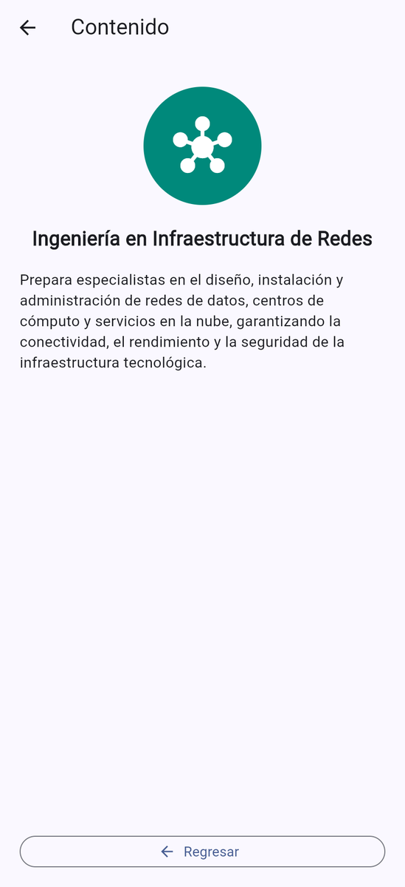<br><sub>Infraestructura de Redes</sub></td></tr>
  <tr><td align="center">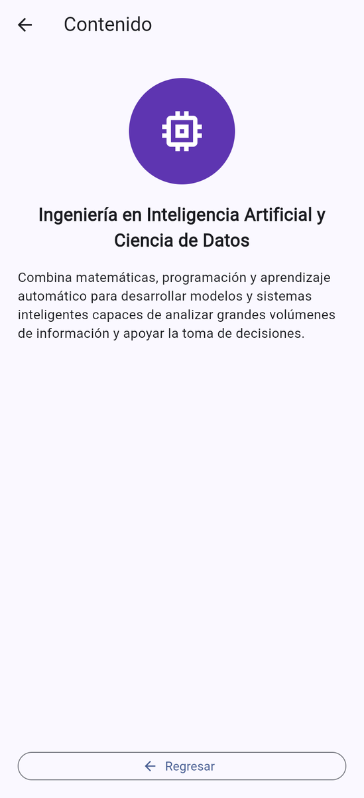<br><sub>IA y Ciencia de Datos</sub></td><td align="center">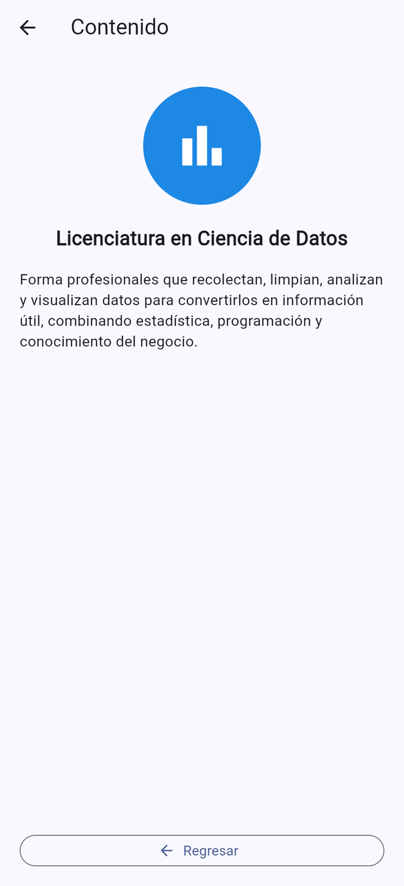<br><sub>Lic. en Ciencia de Datos</sub></td><td align="center">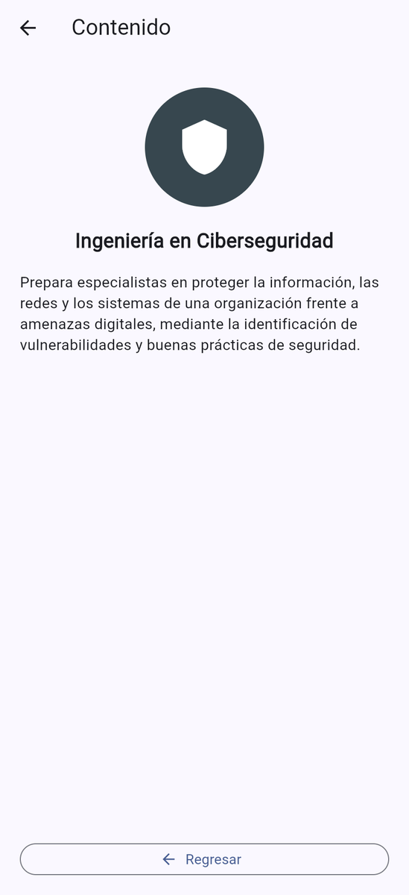<br><sub>Ciberseguridad</sub></td></tr>
</table>

### Capturas incluidas en el PDF de entrega

<table>
  <tr><td align="center">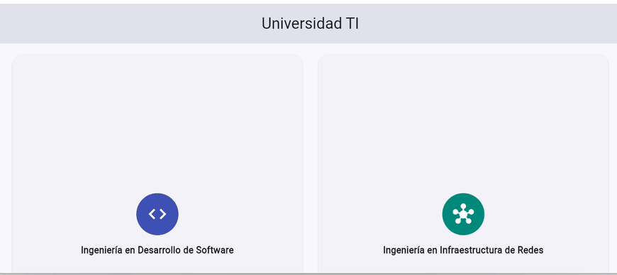<br><sub>Inicio (1/3)</sub></td><td align="center">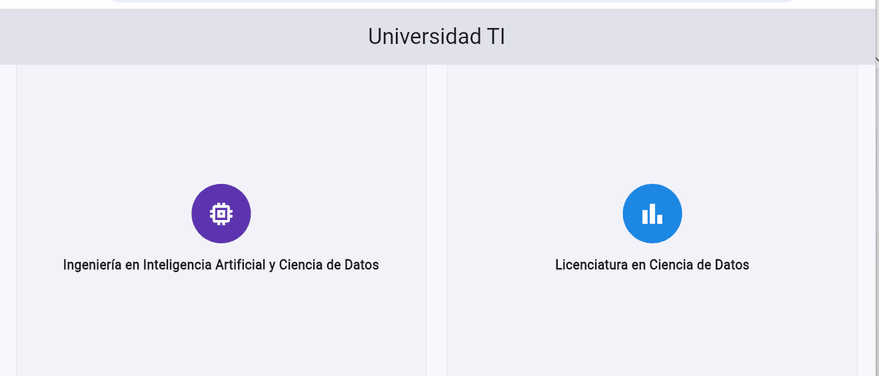<br><sub>Inicio (2/3)</sub></td></tr>
  <tr><td align="center">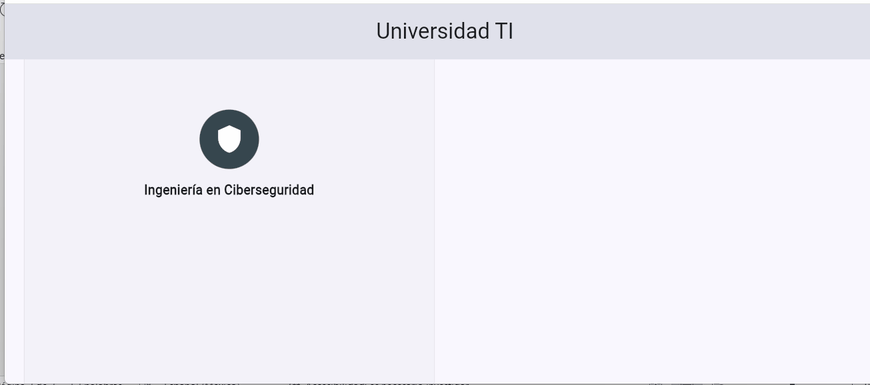<br><sub>Inicio (3/3)</sub></td><td align="center">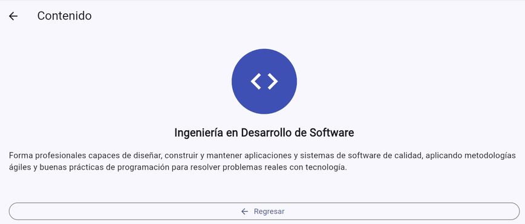<br><sub>Ing. en Desarrollo de Software</sub></td></tr>
  <tr><td align="center">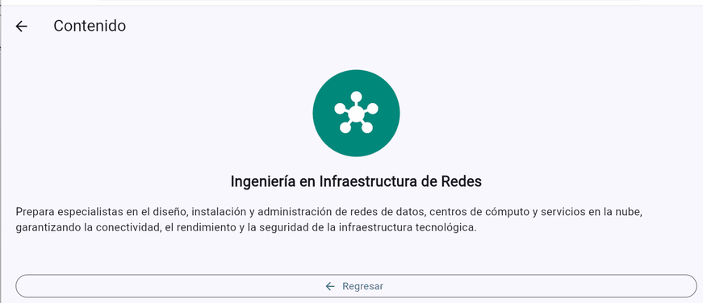<br><sub>Ing. en Infraestructura de Redes</sub></td><td align="center">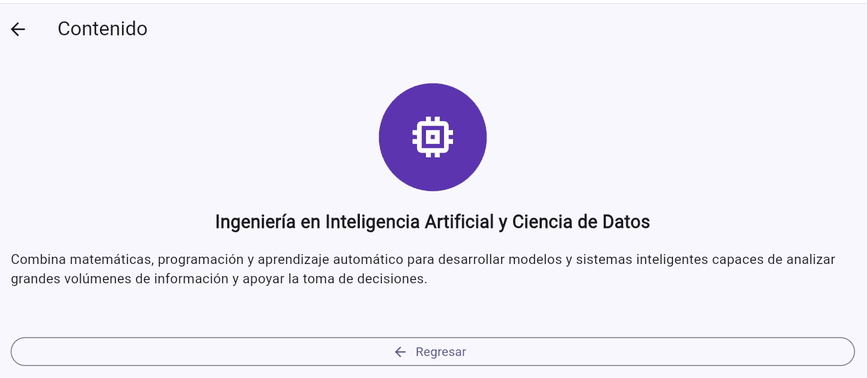<br><sub>Ing. en IA y Ciencia de Datos</sub></td></tr>
  <tr><td align="center">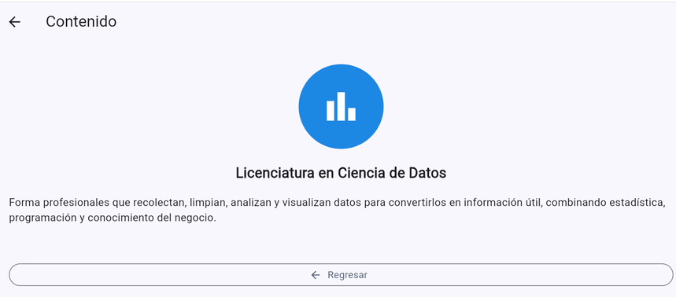<br><sub>Lic. en Ciencia de Datos</sub></td><td align="center">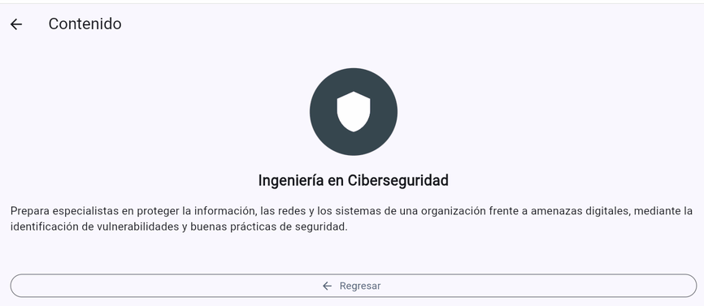<br><sub>Ing. en Ciberseguridad</sub></td></tr>
</table>

## Carreras incluidas

- Ingeniería en Desarrollo de Software
- Ingeniería en Infraestructura de Redes
- Ingeniería en Inteligencia Artificial y Ciencia de Datos
- Licenciatura en Ciencia de Datos
- Ingeniería en Ciberseguridad

## Pruebas (`flutter test`)

Resultado de correr `flutter test`: **5 pruebas pasan** (*All tests passed!*). Revisan el título, las cinco carreras, la rejilla de tarjetas, la navegación a la pantalla de contenido y el botón **Regresar**. Las pruebas están en [`universidad_ti/test/universidad_test.dart`](universidad_ti/test/universidad_test.dart).

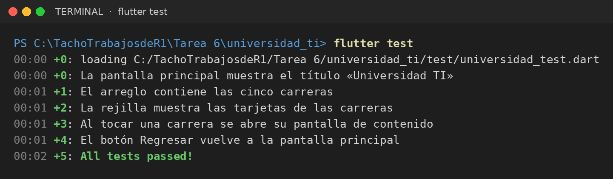

## Estructura del código

```
universidad_ti/lib/
├── main.dart
├── data/carreras.dart              # arreglo con las cinco carreras
├── models/carrera.dart             # modelo Carrera (nombre, ícono, color, descripción)
├── screens/
│   ├── pantalla_principal.dart     # rejilla de 2 columnas con GridView.builder
│   └── pantalla_contenido.dart     # detalle de la carrera y botón Regresar
└── widgets/targeta_carrera.dart    # tarjeta reutilizable
```

## Cómo ejecutar

```bash
cd universidad_ti
flutter pub get
flutter test
flutter run
```

## Documento de entrega

<details>
<summary>Ver las páginas del PDF</summary>

<table>
  <tr><td align="center">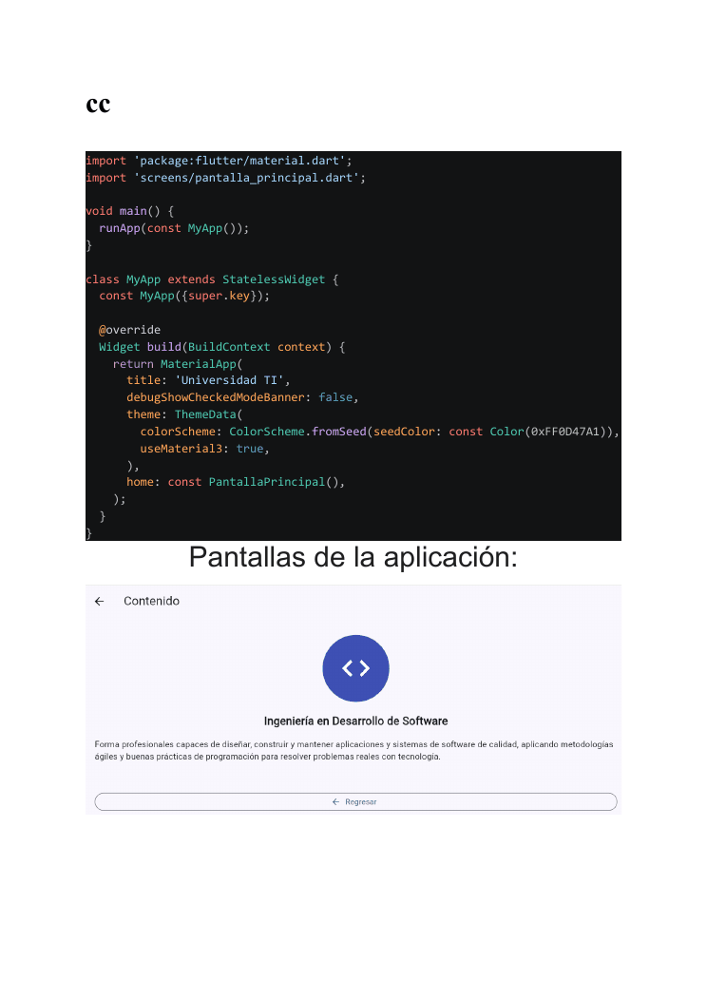<br><sub>Página 1</sub></td><td align="center">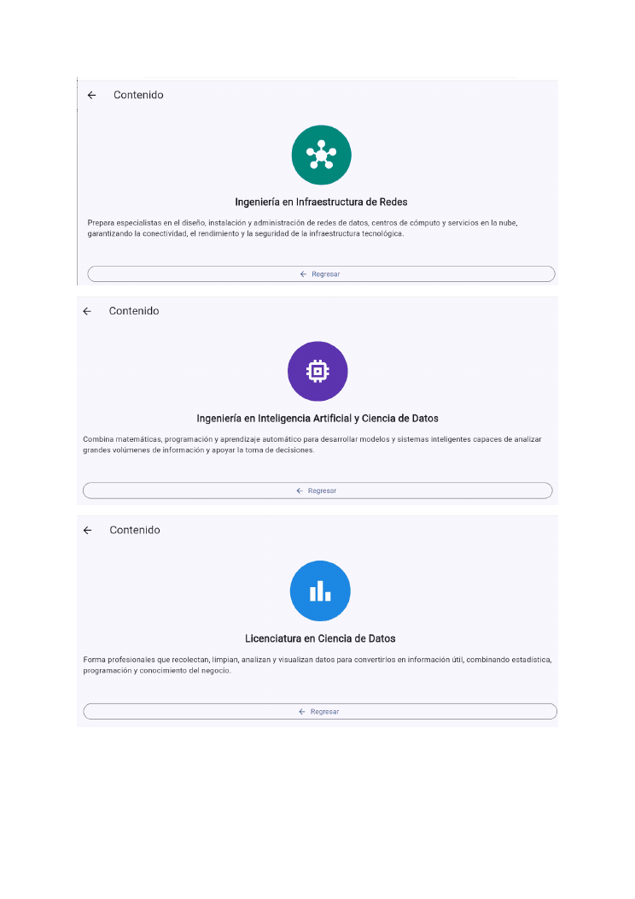<br><sub>Página 2</sub></td><td align="center">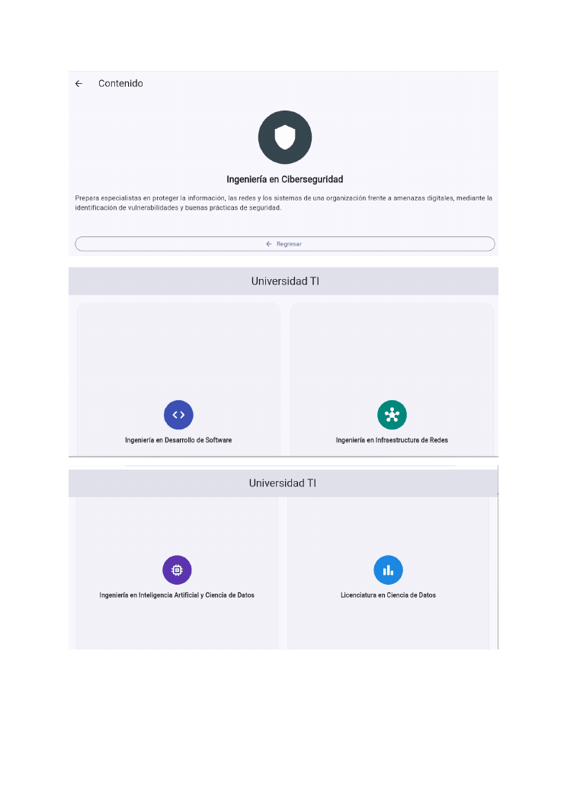<br><sub>Página 3</sub></td></tr>
  <tr><td align="center">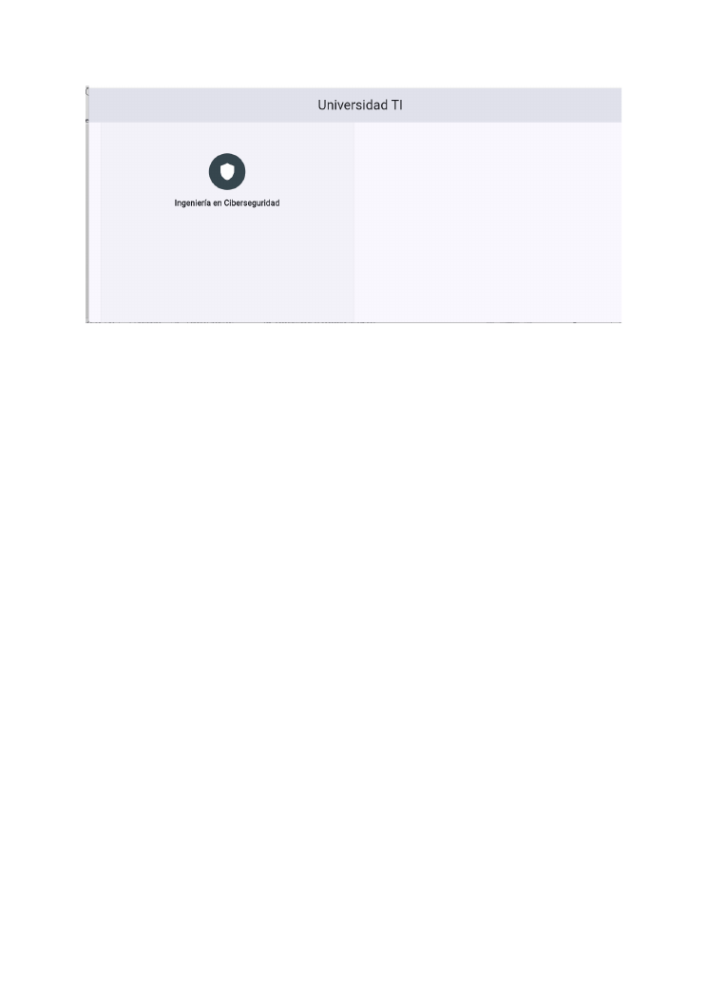<br><sub>Página 4</sub></td></tr>
</table>

</details>
